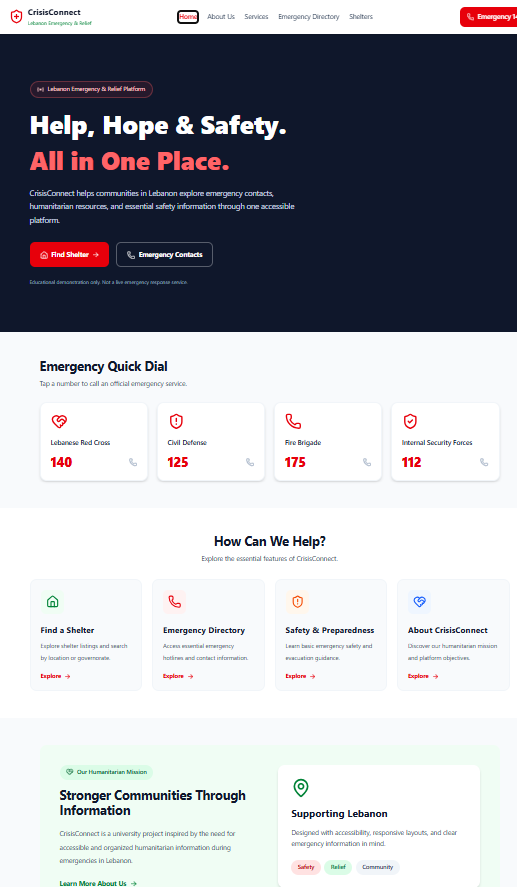
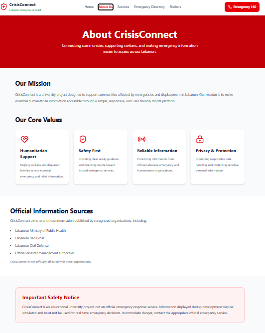
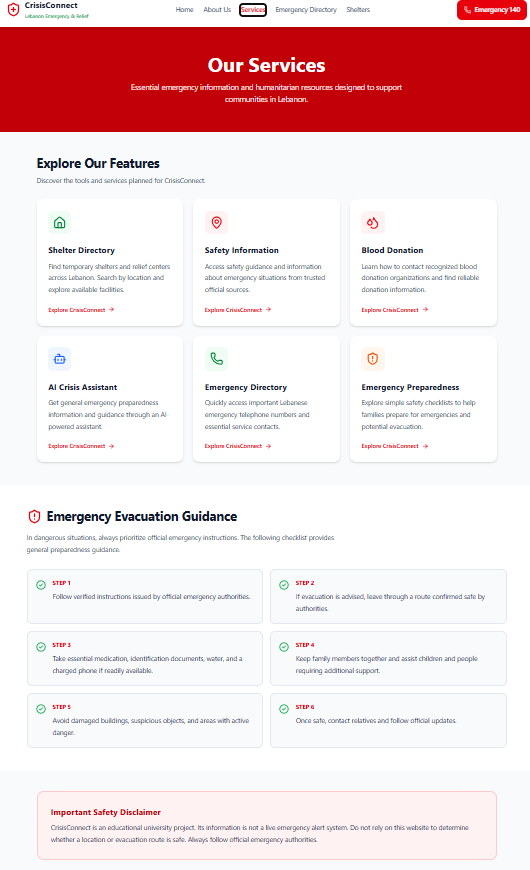
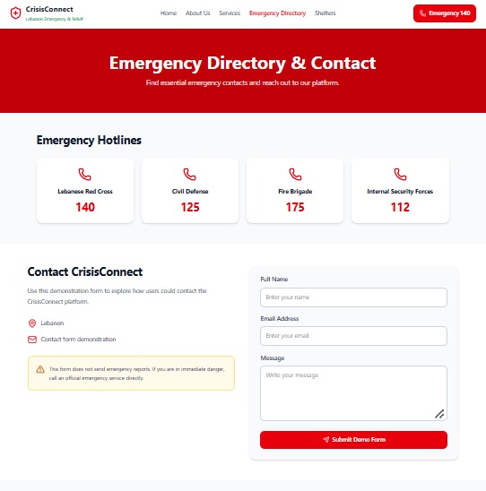
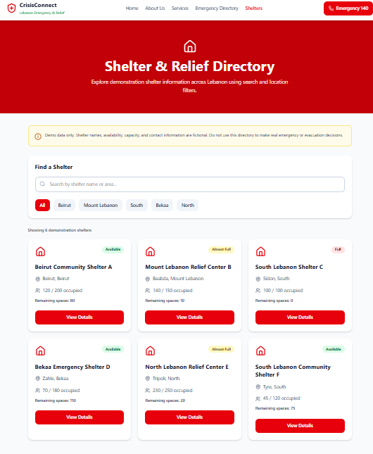

# CrisisConnect 🇱🇧
### National Emergency & Relief Platform

CrisisConnect is a responsive web application developed as a university project for CSCI426 – Advanced Web Programming.

The platform aims to organize essential emergency information, shelter demonstrations, and safety resources for communities in Lebanon.

> **Disclaimer:** CrisisConnect is an educational demonstration. Shelter information and availability are fictional. This website is not an official emergency response service.

## Features

- Responsive design for desktop, tablet, and mobile
- Five pages with React Router
- Emergency hotline directory
- Shelter search and governorate filtering
- Shelter availability indicators
- Interactive shelter details modal
- Safety and preparedness information
- Demonstration contact form
- Safety information ticker
- Automatic scroll-to-top on page navigation

## Pages

1. **Home** – Platform overview, emergency contacts, and services
2. **About Us** – Project mission and objectives
3. **Services** – Safety and preparedness resources
4. **Emergency Directory** – Emergency hotlines and demo contact form
5. **Shelters** – Interactive shelter directory with search, filters, and details

## Technologies Used

- React.js
- Create React App (react-scripts)
- JavaScript
- React Router DOM
- Tailwind CSS
- Lucide React
- HTML5 and CSS3
- Git and GitHub
- Netlify

## Installation

Clone the repository:

```bash
git clone https://github.com/abdallah-9primo/CSCI426-CrisisConnect.git
```

Navigate into the project directory:

```bash
cd CSCI426-CrisisConnect
```

Install dependencies:

```bash
npm install
```

Start the development server:

```bash
npm start
```

Open the local URL displayed in the terminal.

## Deployment

The project is deployed on Netlify.

Live website:
https://lambent-pithivier-1eee6f.netlify.app/

GitHub repository:
https://github.com/abdallah-9primo/CSCI426-CrisisConnect

## Project Structure

```text
src/
├── assets/
├── components/
│   ├── BreakingNewsTicker.js
│   ├── Footer.js
│   ├── Navbar.js
│   └── ScrollToTop.js
├── data/
│   ├── newsData.json
│   └── sheltersData.json
├── pages/
│   ├── About.js
│   ├── Contact.js
│   ├── Home.js
│   ├── Services.js
│   └── Shelters.js
├── App.js
├── index.css
└── index.js
```

## Dynamic Functionality

The Shelters page demonstrates React state management through:

- Live text search
- Governorate filters
- Dynamic rendering with `map()`
- Conditional rendering
- Shelter detail modals
- Capacity and occupancy calculations

The contact form demonstrates basic form handling and validation.

No form submissions are transmitted or stored.

## Future Improvements

- Integration with verified emergency information providers
- Multilingual support
- Accessibility enhancements
- Optional AI assistant
- Real-time shelter updates, subject to verified data availability

## Academic Information

Course: CSCI426 – Advanced Web Programming

Project: Phase 1

Project Name: CrisisConnect

Purpose: Educational and academic demonstration.


## Application Screenshots

### 1. Home Page


### 2. About Us


### 3. Services & Features


### 4. Emergency Directory & Contact


### 5. Shelter & Relief Directory

